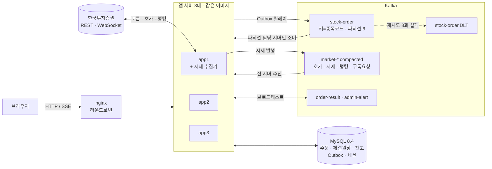

# 📈 한국투자증권 Open API 기반 모의투자 체결 시스템

한국투자증권(KIS) 실시간 시세를 받아, **외부 증권사에 주문을 넘기지 않고 직접 만든 매칭 엔진으로 체결까지 처리**하는 모의투자 시스템입니다.
처음엔 서버 1대·H2 파일 DB 구조였고, 이번 고도화에서 **동시성 정합성 → 메시지 신뢰성 → 서버 여러 대(수평 확장)** 순서로 구조를 바꿨습니다. 정규장(09:00~15:30)에만 체결하고 그 외 시간엔 종가를 보여줍니다.

- 📐 설계 문서: [DB 설계](docs/db-design.md) · [API 설계](docs/api-design.md) · [OpenAPI 스펙](docs/openapi.yaml) · [이슈/검증 기록](issue.md) · [기술 스택 정리](skill.md)

---

## 🆕 이번 고도화에서 추가로 구현한 것 (2026-10)

| # | 문제 (기존 구조) | 구현 | 검증 |
|---|---|---|---|
| 1 | 즉시체결이 **락 밖에서 읽은 주문 상태**로 체결 → 배치와 같은 주문을 이중 체결, 취소된 주문도 체결 | 종목 락 안에서 주문 재조회 + 상태 확인 | 경쟁 순서를 고정한 단위·통합 테스트. 수정 전 코드에선 Trade 2건(이중 체결) 재현 |
| 2 | 같은 회원의 동시 주문이 **잔고·보유수량을 넘어서 접수**, 잔고 증감끼리 덮어써서 **금액 유실** | 주문 접수 시 회원 행 비관적 락(`SELECT … FOR UPDATE`) + 잔고는 `seed = seed + delta` 원자적 UPDATE | 수정 전: 잔고로 2건만 가능한데 5건 접수, 잔고 증감 동시 실행 시 **2,100,000원 유실**(MySQL) → 수정 후 정확 |
| 3 | 사용자 취소와 체결이 겹치면 **체결도 되고 환급도 됨**, 취소된 주문이 체결로 되살아남 | `Order @Version` 낙관적 락 + 체결(주문·Trade·잔고)을 한 트랜잭션으로, 취소가 지면 409. 락 순서 통일(주문 → 회원)로 데드락 방지 | 양방향 경쟁 모두 재현 테스트, `@Version` 빼면 실패 |
| 4 | 주문 저장과 Kafka 발행이 따로 → 발행 실패 시 **메시지 유실**, 컨슈머가 **예외를 삼켜** 실패한 메시지가 어디에도 안 남음 | **Transactional Outbox**(즉시 발행 + 1초 주기 재발행, 행 락으로 이중 발행 방지) + 재시도 3회 → **DLQ** → DB 적재·관리자 알림·재발행 API + 멱등 컨슈머 | 실제 Kafka 컨테이너로 DLQ·재발행 검증. 릴레이 락 빼면 같은 메시지 **5번 전송** |
| 5 | 체결 동시성 제어가 JVM 메모리(`synchronized`·메모리 호가창) → **서버 2대부터 깨짐** | **종목 = Kafka 파티션 = 한 서버(단일 writer)**: 주문 키를 종목코드로, 파티션을 받은 서버만 그 종목 체결. 리밸런스 시 진행 중 체결 완료 후 인계(cooperative) | 서버 3대 실제 실행: 파티션 2개씩 분배, 담당 서버 종료 시 다른 서버가 대기 주문 인계, 취소·환급 1번만 |
| 6 | 서버마다 KIS에 따로 연결 → **KIS 호출 한도·토큰 발급 제한을 서버 수만큼 소모**, 장마감 저장 중복 | **시세 수집기 1대만 KIS와 통신**, 시세는 compacted 토픽으로 전 서버 브로드캐스트 → 장 마감 후 새로 뜬 서버도 **종가 즉시 표시** | 3대 중 수집기만 토큰 발급·웹소켓 연결, 3대 모두 같은 종가 랭킹·시세 |
| 7 | 세션·체결 알림이 서버 메모리 → 다른 서버로 가면 로그아웃, 알림 누락 | **Spring Session JDBC**(MySQL) + 체결 결과·관리자 알림 Kafka 브로드캐스트 → nginx **라운드로빈**(sticky 불필요) | 로그인한 서버와 다른 서버 요청도 200, SSE 3개(서버 3대)에 체결 알림 정확히 1번씩 |
| 8 | H2 파일 DB(프로세스 1개만 접근), 테스트가 **운영 DB·실제 KIS API**를 씀 | MySQL 8.4 전환, 통합 테스트 Testcontainers(MySQL·Kafka), 핫패스 인덱스 3개 | 전체 47건 테스트, 인덱스 적용 시 핫패스 **41~70ms → 0.01~11ms**(합성 데이터 20만 건) |
| 9 | KIS **접근토큰·승인키가 로그에 그대로** 남음, 연결 로그가 주기적으로 반복 | 토큰 로그 제거, 연결 로그는 "기동 시도/성공/끊김/재연결"만 | 로컬 웹소켓 서버를 끊었다 켜는 테스트로 로그 4줄 확인 |

모든 수정은 **"수정을 하나씩 빼고 돌리면 그 테스트만 실패한다"** 를 확인하는 방식으로 검증했습니다(자세한 경위·수치: [issue.md](issue.md)).

---

## 🏗 아키텍처



- **체결**: 종목코드가 Kafka 키라 한 종목의 주문은 항상 같은 파티션 → 그 파티션을 가진 서버 한 곳만 체결(서버 사이 락 없음).
- **시세**: KIS와 통신하는 건 app1(수집기)뿐. 나머지는 Kafka로 받음. compacted 토픽이 종목별 마지막 값을 보관해 장 마감 후 기동해도 종가가 바로 보임.
- **세션·알림**: 세션은 MySQL, 체결 결과·관리자 알림은 Kafka 브로드캐스트 → 어느 서버에 붙어도 같은 결과.

## 🔗 주문 처리 흐름

```
[1] POST /api/order/create  ─ 한 트랜잭션 ───────────────────────────────────────────┐
     회원 행 락(FOR UPDATE) → 잔고/보유수량 확인 → 매수 금액 예약 차감 → 주문 PENDING 저장 │
     → Outbox에 "보낼 메시지" 기록                                                  ─┘
[2] 커밋 후 Outbox 즉시 발행 (실패하면 1초마다 재발행, 행 락으로 한 번만)  → 응답 {orderId}
[3] Kafka stock-order (키 = 종목코드) → 그 종목 파티션을 가진 서버의 컨슈머만 수신
[4] 호가창(우선순위 큐)에 등록(주문ID로 멱등) + 즉시체결 시도 ─ 종목 락 안에서 주문 재조회·상태 확인
     ↳ 정규장이 아니면 대기만. 실패한 메시지는 재시도 2번 후 DLT → DB 적재 → 관리자 재발행
[5] 체결 = 한 트랜잭션: 주문 UPDATE(@Version) → Trade INSERT → 잔고 차액 환급(원자적 UPDATE)
[6] 체결 결과 → Kafka order-result → 모든 서버가 받아 자기 SSE 연결로 전달
[7] 미체결분은 30초 배치(자기 담당 종목만)로 재시도, 장 마감까지 남으면 자동 취소·환급
```

---

## 🧭 설계 근거와 트레이드오프

### 1. 다중 서버 체결 - 분산락 대신 파티션 소유권(단일 writer)
| 대안 | 판단 |
|---|---|
| Redis/DB 분산락 | 체결마다 네트워크 왕복, 락 TTL 만료·GC 멈춤·시계 오차 때 두 서버가 동시에 락을 가졌다고 믿는 문제. 락 저장소가 새 장애 지점 |
| 리더 1대만 체결 | 단순하지만 체결 처리량이 서버 1대로 고정 |
| **Kafka 파티션 소유권 (선택)** | 키 = 종목코드 → 한 종목 = 한 파티션 = 한 서버. 실제 거래소의 "종목별 단일 매칭 엔진"과 같은 모델, 서버 사이 락이 필요 없음 |

- **대가**: 리밸런스(서버 추가·종료) 순간이 위험 구간 → 반납 콜백에서 ① 소유권 해제 ② 종목 락을 잡아 진행 중 체결이 끝날 때까지 대기 ③ 호가창 정리. Kafka는 이 콜백이 끝나야 파티션을 넘기므로 겹치지 않음. 마지막 안전장치는 `@Version`.
- 한 종목에 주문이 몰리면 그 파티션 서버 하나가 다 받음(hot partition) - 종목 단위 순서 보장과 맞바꾼 한계.

### 2. 시세 - 수집기 1대 + compacted 토픽
- 서버마다 KIS에 붙으면 호출 한도·토큰 발급 제한(분당 1회)을 나눠 쓰고 장마감 스냅샷 저장도 겹침 → KIS 통신을 한 곳으로 모음.
- compacted 토픽(키 = 종목코드)은 종목별 마지막 값을 계속 보관 → 서버가 장 마감 후 새로 떠도 처음부터 읽으면 종가로 화면을 채움. "정규장 외엔 종가 표시" 요구를 서버 재시작과 무관하게 지킴.
- **대가**: 수집기가 단일 장애점 - 죽으면 시세가 마지막 값에서 멈춤(아래 한계 참고).

### 3. 메시지 신뢰성 - Transactional Outbox
| 대안 | 판단 |
|---|---|
| 커밋 후 바로 send, 실패 시 로그 | 유실 그대로 |
| CDC(Debezium) | 표준적이지만 Kafka Connect 인프라 추가 - 이 규모에서 과함 |
| **폴링 릴레이 + 커밋 직후 즉시 발행 (선택)** | 추가 인프라 없음. 평소엔 즉시 발행이라 지연 거의 없고, 실패 시에만 1~2초 지연 |

- 발행은 "최소 한 번" → 컨슈머는 중복에 안전하게: 호가창 등록은 주문ID로 멱등, 체결은 락 안 상태 재확인 + `@Version`으로 한 번만 성공. 별도 "처리한 메시지 ID" 테이블 대신 주문ID를 자연 멱등키로 씀.
- **대가**: 행 락을 잡은 채 Kafka 전송(최대 5초)을 기다림 - 브로커가 느리면 그 이벤트 행 락도 길어짐. 대신 이중 발행을 DB 락 하나로 막음.

### 4. 동시성 제어 - 문제마다 다른 도구
| 문제 | 선택 | 다른 도구를 안 쓴 이유 |
|---|---|---|
| 같은 회원 동시 주문 | 비관적 락(회원 행) | 매도의 "보유 - 대기 매도"는 다른 테이블 합계라 조건부 UPDATE 한 줄로 표현 불가. 경합 범위가 회원 1명뿐이라 대기 비용이 작음 |
| 잔고 증감 | 원자적 UPDATE | 환급은 확인 없이 더하기만 - 읽을 필요 자체가 없음 |
| 취소 vs 체결 | 낙관적 락(`@Version`) | `synchronized`는 서버 1대에서만 유효. 충돌이 드물어 실패한 쪽만 롤백하면 됨 |

### 5. 세션 공유 + 라운드로빈 (sticky 안 씀)
- sticky session은 로그인만 가려줄 뿐, "체결은 B 서버, SSE는 A 서버" 문제는 못 풀고, 서버가 죽으면 묶인 사용자가 같이 끊김. → 세션은 DB, 알림은 Kafka로 서버에서 상태를 빼고 라운드로빈.
- **대가**: 요청마다 세션 DB 조회, 로그인 사용자 객체를 직렬화해야 함(그래서 `Member`가 `Serializable`).

### 6. 인덱스 - 측정해서 필요한 것만
- 대기 주문은 전체의 소수이고 끝난 주문은 계속 쌓임 → `(order_status, stock_code)` 하나로 30초 배치·파티션 할당·매도 예약 수량 조회를 함께 해결. 매도용 전용 인덱스는 만들었다가 옵티마이저가 안 써서 측정 후 삭제, Outbox 추가 인덱스도 기존 인덱스로 충분해서 안 만듦.
- 결과(합성 데이터 주문 20만·체결 15만 건, `EXPLAIN ANALYZE` 5회 중앙값): 30초 배치 **43.4 → 3.58ms**, 매도 접수(회원 락 안) **49.4 → 0.014ms**, 주문 내역 **69.9 → 0.24ms**, 보유·손익 **41.5 → 0.148ms**. 쓰기 비용은 주문 1건당 약 0.005ms. 상세: [docs/db-design.md](docs/db-design.md#4-인덱스-설계---핫패스-기준)

---

## 🔐 인증 · 인가

| 구분 | 구현 |
|---|---|
| 인증 | Spring Security 폼 로그인(BCrypt) + **카카오 OAuth2**(최초 로그인 시 자동 가입, 탈퇴 계정은 로그인 차단). 두 방식 모두 같은 `CustomerDetails`(`UserDetails` + `OAuth2User`)로 처리 |
| 세션 | **Spring Session JDBC**(MySQL) - 서버 몇 대든 같은 세션. 관리자 화면의 로그인 세션 수도 이 테이블 기준 |
| URL 인가 | 시세·랭킹·뉴스·가입·로그인은 공개, 주문·내역·마이페이지는 인증 필요. SSE 비동기 디스패치(`DispatcherType.ASYNC`)도 허용해 스트림이 403 나지 않게 함 |
| 리소스 인가 | 회원 ID를 경로·쿼리로 받는 API가 없음 - 모든 조회가 세션의 회원 ID 기준(IDOR 경로 없음). 주문 취소는 본인 주문인지 확인하고, 아니면 없는 주문과 똑같이 404 |
| 서버가 정하는 값 보호 | 가입 시 잔고·레벨·상태·가입경로, 주문 시 주문ID·회원ID·상태·체결수량·버전은 요청 값을 무시하고 서버가 설정 |
| 관리자 | `/admin/**`, `/api/admin/**`는 로그인 회원 ID가 설정값 `admin.member-id`와 같을 때만(기본값 비어 있음 = 아무도 못 들어감) |
| 시크릿 | KIS·카카오·네이버·Anthropic 키는 환경변수 또는 gitignore된 `application-secret.yaml`로만 주입. 토큰·승인키는 로그에 남기지 않음 |

**아직 부족한 점(다음 단계)**: 역할(Role) 체계 없이 관리자 1명을 ID로 비교 / 세션 쿠키 인증인데 CSRF 보호를 꺼 둠(→ CSRF 토큰 + `SameSite`) / 요청 본문을 엔티티로 받아 서비스에서 필드를 덮어쓰는 방식(→ 요청 DTO 분리) / 주문 멱등키 없음.

---

## 🧱 인프라 · 실행 (로컬)

운영(EC2) 배포는 하지 않고, 로컬 Docker Compose로 다중 서버 구성까지 재현합니다.

**서버 1대(개발)**
```bash
docker compose up -d mysql          # MySQL 8.4 (호스트 3307)
./gradlew bootRun                   # Kafka는 로컬 설치본 localhost:9092
```

**서버 여러 대(nginx + 앱 3대 + 전용 Kafka)**
```bash
./gradlew bootJar
docker compose --profile cluster up -d --build   # http://localhost:8088
docker compose --profile cluster stop
```

| 구성요소 | 역할 | 비고 |
|---|---|---|
| nginx | 라운드로빈 로드밸런서 | SSE용 `proxy_buffering off`·`proxy_read_timeout 1h`, `X-Forwarded-*`로 원래 호스트·포트 전달 |
| app1 | 웹 + 체결 + **시세 수집기**(`MARKET_DATA_COLLECTOR=true`) | KIS 토큰·웹소켓은 이 서버만 |
| app2, app3 | 웹 + 체결 | 같은 이미지, 수집기만 끔 |
| Kafka (KRaft) | 주문·시세·알림·DLT 토픽 | 토픽은 앱이 기동 시 생성(브로커 자동 생성에 의존 안 함) |
| MySQL 8.4 | 데이터 + 세션 | |
| Loki + Grafana | 로그 수집·조회(선택) | `observability/`, `LOKI_URL`을 설정해야만 켜짐 |

- 시크릿 파일은 이미지에 넣지 않고 컨테이너에 읽기 전용으로 마운트.
- `./gradlew test`는 MySQL·Kafka 컨테이너를 띄우므로 Docker 필요.
- **CI/CD 파이프라인은 아직 없음** - 테스트·빌드·이미지 생성은 수동(다음 단계: GitHub Actions에서 Testcontainers 테스트 + 이미지 빌드).

---

## ✅ 검증

**테스트 47건** (단위 + 실제 MySQL·Kafka 컨테이너 통합 테스트 + 서버 2대 E2E)

| 영역 | 무엇을 | 수정을 빼면 |
|---|---|---|
| 동시 주문 | 잔고 100만 원으로 50만 원 매수 5건 동시 → 2건만 | 5건 전부 접수 |
| 잔고 증감 | 취소 환급 5건 + 신규 매수 5건 동시 → 잔고 정확 | 2,100,000원 유실 |
| 취소 vs 체결 | 양쪽 순서 모두 → 한쪽만 반영 | 체결+환급 동시 발생 / 취소 주문 부활 |
| 즉시체결 vs 배치 | 락 대기 중 상태 변경 → 체결 1번 | Trade 2건 |
| Outbox | 주문·이벤트 원자성, 발행 실패 후 재시도, 5곳 동시 발행 → 1번 | 5번 전송 |
| DLQ (실제 Kafka) | 깨진 메시지 즉시 DLT, 처리 실패 3번 시도 후 DLT, 재발행 | DLQ에 아무것도 안 남음 |
| 파티션 소유권 | 종목→파티션 계산이 Kafka와 일치, 남의 종목 안 건드림, 반납 시 진행 중 체결 대기 | 체결 도중 반납 완료(겹침) |
| 시세 버스 (실제 Kafka) | 수집기 아닌 서버가 KIS 호출 없이 Kafka로만 시세 수신, compacted 확인 | - |
| **다중 서버 E2E** (Kafka·MySQL 컨테이너 + 앱 2대) | 파티션 6개를 겹치지 않게 분배 → 종목별로 담당 서버만 호가창에 올리고 1번 체결, 잔고 정확 → 담당 서버 종료 시 다른 서버가 대기 주문을 DB에서 올려 체결 | 키를 주문ID로 되돌리면 주문이 담당 아닌 서버로 가서 체결 안 됨 / 인수 시 로드를 빼면 대기 주문 미인계 |
| 연결 로그 | 끊김/재연결 로그 4줄만, 승인키 노출 없음 | 재시도마다 경고 반복 |

**실제 3대 클러스터 실행** (장 마감 후): 파티션 2개씩 분배(늦게 붙은 서버에는 필요한 파티션만 이동) · KIS 연결은 수집기만 · 3대 모두 같은 종가 · 로그인 서버와 다른 서버 요청도 같은 사용자 · 주문은 담당 서버만 소비 · 담당 서버 종료 시 다른 서버가 대기 주문 인계, 재기동 후 취소·환급 1번.

---

## ⭐ 기존 핵심 기능

### 자체 매칭 엔진 - 가격-시간 우선순위 + 자동 가격개선
- 종목별 매수/매도 **우선순위 큐(Heap)** 로 가격-시간 우선순위 유지(매수는 높은 가격, 매도는 낮은 가격 먼저, 같으면 먼저 낸 주문). 큐엔 정렬용 불변 스냅샷만 두고 체결 직전 DB 최신 상태를 `findAllById`로 한 번에 조회(취소된 주문은 이 시점에 걸러짐).
- **호가 10단계 잔량만큼만 부분체결**, 같은 호가 틱의 잔량을 즉시체결·배치가 나눠 써서 화면에 보인 물량 이상 체결되지 않음.
- **자동 가격개선 5% 밴드**: 지정가 매수가 더 싼 매도호가를 만나면 그 가격에 체결하되, 지정가보다 5% 넘게 싼 호가는 제외(이상 데이터 보호). 화면 체크박스로 켜고 끔.
- **체결 원장(Trade) 분리**: 체결마다 불변 INSERT, 주문은 누적 상태만.

### FDS(이상거래탐지)
| 규칙 | 조건(기본값) | 시점 |
|---|---|---|
| 과다 주문 빈도 | 60초 내 10회 이상 | 주문 접수 |
| 초단타 왕복매매 | 60초 내 같은 종목 반대매매 | 체결 |
| 가격 이상치 | 현재가 대비 20% 이상 이탈 | 주문 접수 |

차단하지 않고 관찰만(오탐이 정상 거래를 막지 않게) - 로그 + 관리자 실시간 알림.

### 실시간 시세
- KIS 웹소켓 **호가(H0STASP0) 단일 채널**만 구독하고 현재가·등락률은 호가 + 전일종가로 계산 → 종목당 실시간 등록 **2건 → 1건(50%↓)**, 세션 한도 안에서 지원 종목 수 확대.
- 랭킹은 KIS에 실시간 API가 없어 30초 REST 폴링(수집기만), 장 마감 후엔 종가 스냅샷.

### AI 뉴스 영향 분석
- 네이버 뉴스(최근 1일) → **Claude 구조화 출력**으로 "오늘 등락이 이 뉴스와 관련 있는지, 방향과 근거" 분석. 실질 재료가 없으면 억지로 보여주지 않음. 종목·일 단위 캐시.

### 운영 도구
- `/admin/orders`: 미체결 주문과 미체결 사유(호가 없음/체결 가능 호가 없음/시스템 오류), 주문별 로그를 Loki에서 바로 조회.
- 관리자 실시간 알림(SSE): 체결 시스템 오류, FDS 탐지, DLQ 적재. DLQ 목록·재발행 API.

---

## 🖥 화면 구성 (모바일 가능)

<table>
  <tr>
    <td align="center" width="33%"><b>메인 화면</b><br/>(주식 랭킹, 거래 내역 & 수익률)<br/></td>
    <td align="center" width="33%"><b>매수</b><br/><br/></td>
    <td align="center" width="33%"><b>매도</b><br/><br/></td>
  </tr>
  <tr>
    <td align="center"><b>로그인</b><br/><br/></td>
    <td align="center"><b>회원가입</b><br/><br/></td>
    <td></td>
  </tr>
</table>

## 🛠 기술 스택

| 분류 | 기술 |
|---|---|
| Language / Framework | Java 21, Spring Boot 4, Spring Security(OAuth2 Client), Spring Session JDBC |
| Data | MySQL 8.4, JPA/Hibernate |
| Messaging | Apache Kafka(KRaft) - Outbox, DLQ, compacted 토픽, cooperative 리밸런스 |
| 실시간 | KIS WebSocket(수신), SSE(브라우저) |
| 외부 연동 | WebClient(KIS REST), 네이버 뉴스 API, Anthropic Claude API, 카카오 로그인 |
| Infra (로컬) | Docker Compose, nginx, Grafana Loki + Grafana |
| Test | JUnit 5, Mockito, Testcontainers(MySQL·Kafka), k6(부하), JFR(프로파일링) |

## 📂 프로젝트 구조

```
src/main/java/stockOrder/stockTrade
├── token     # KIS 접근토큰·웹소켓 승인키 발급
├── kis       # KIS 연동(수집기) + MarketDataBus(시세 Kafka 브로드캐스트)
├── order     # 주문 API, 접수/취소 트랜잭션(OrderCommandService), 주문 컨슈머, Kafka 재시도·DLQ 설정
├── matching  # 매칭 엔진, 호가창(OrderBook), 파티션 소유권(StockOwnership), 체결 결과 브로드캐스트
├── outbox    # Transactional Outbox 릴레이, DLQ 적재·재발행
├── member    # 회원, 폼/카카오 로그인
├── stock     # 장마감 랭킹 스냅샷
├── news      # 뉴스 + Claude 영향 분석
├── fds       # 이상거래탐지
├── admin     # 미체결 모니터링, Loki 조회, 관리자 알림
├── security  # Spring Security
└── view      # Thymeleaf 페이지
```

---

## 📌 트러블슈팅 (복잡도·중요도 높은 이슈만)

| 문제 | 원인 & 해결 | 성과 |
|---|---|---|
| **랭킹 캐시가 시간이 지날수록 계속 불어나 화면이 10~20초씩 느려짐** | 앱 재시작 시 캐시를 복원하는 쿼리에 날짜 필터가 없어 DB에 쌓인 **모든 날짜**의 EOD 스냅샷을 통째로 읽어와 누적 → 최신 날짜 스냅샷만 정확히 골라오는 쿼리로 교체, 캐시 채우기 전 방어적 초기화 추가 | **(실측)** 랭킹 캐시 15,540건 → **30건**, 메인화면 DOM 노드 264,259개 → **589개(99.8%↓)** |
| (위 수정 이후 재검증 중 발견) 앱을 하루에 여러 번 재기동하면 같은 날짜 랭킹이 계속 중복 저장됨 | 장마감 랭킹 저장 가드가 인메모리 플래그라 재기동마다 초기화됨 → DB에 오늘 데이터가 이미 있는지까지 같이 확인하도록 가드 강화, 기존 중복 데이터 정리 | **(실측)** 재기동 반복으로 480건까지 불어났던 당일 데이터 → **30건**, 재기동 반복해도 재발 안 함 확인 |
| 서버 기동 후 일정 개수 이상 종목을 보면 신규 종목이 영구 미체결 | 종목당 실시간 채널 2개(체결가+호가) 구독 + 구독 한도 초과 시 REST 폴백 경로 부재(호가는 REST 자체가 없는 값) → 체결가 구독 제거, 호가 단일 채널만 구독하고 현재가/등락률은 호가+전일종가로 계산해 대체 | 종목당 실시간 등록 **2건 → 1건(50%↓)**, 세션 한도 내 동시 지원 가능 종목 수 확대 |
| 대기 주문 매칭이 지정가와 무관하게 접수 순서로만 처리됨 | 매칭 대상 조회가 시간순으로만 정렬되어 있어 가격 조건이 반영 안 됨 → 매수는 지정가 높은 순, 매도는 지정가 낮은 순으로 우선 처리하도록 수정(이후 이 우선순위 결정 자체를 종목별 **PriorityQueue(Heap)** 기반으로 재설계 — 위 "자체 주문 매칭 엔진" 항목 참고) | 실제 거래소 원칙(가격-시간 우선순위)과 일치하는 체결 정합성 확보 |
| 보유주식 실시간 스트림이 DB 커넥션 풀을 고갈시켜 주문/보유종목 등 DB를 쓰는 API 전체가 500 에러로 번짐 | 가격 틱마다(초당) 캐싱 없이 DB를 재조회 → 회원 단위 1.5초 TTL 캐시 추가, 실제 체결 시에만 즉시 무효화해 정확성은 유지 | 반복 조회 시 DB 쿼리 스킵, 커넥션 풀 고갈 재발 방지 |
| 웹소켓이 "message too big"(1009)으로 끊김 | 여러 종목 동시 구독 시 기본 텍스트 메시지 버퍼(8KB)를 초과 → `WebSocketContainer` 버퍼 크기를 1MB로 확대 | 버퍼 **8KB → 1MB(128배)**, 다종목 동시구독 시 연결 끊김 제거 |
| 매수 잔고 차감/환급과 주문 상태 저장이 원자적이지 않아, 처리 도중 예외가 나면 "잔고만 변하고 주문 기록은 안 남는" 상태가 될 수 있음 | 잔고 변경(`memberRepository.save`)과 주문 상태 저장(`orderRepository.save`)이 각각 별도로 커밋되는 구조였음 → 매수 주문 생성, 주문 취소, 장마감 자동취소 3개 경로 모두 `@Transactional`로 묶어서 원자적으로 처리 | 격리된 재현 테스트로 환급 금액이 1원 오차 없이 정확히 복구되는 것 확인 |
| 매칭 배치가 우선순위 큐에서 주문을 하나 꺼낼 때마다 `findById`로 DB를 건건이 재조회(N+1) | 큐를 우선순위 순서대로 전부 꺼낸 뒤 `findAllById`로 1회 배치 조회하도록 변경(체결 순서·가격-시간 우선순위 로직은 그대로) | **(실측, JFR 202초 프로파일링)** Old GC 41→**7회(-83%)**, Young GC 609→496회(-18.6%), 처리량 +7.3%. 단 부하생성기와 서버가 CPU를 공유하는 로컬 환경이라 응답 p95까지의 개선은 확인 못 함 |
| AI 뉴스 영향 분석이 배포 후 한 번도 성공한 적이 없었는데 화면상 "분석 중"으로만 보여 몇 주간 방치됨 | Anthropic API 키 미설정(빈 문자열이 `x-api-key`로 전송 → 401) + 이후엔 크레딧 잔액 부족(400). `NewsAnalysisService`의 `try/catch`가 예외를 삼키고 "분석 중"으로 폴백해 실패가 드러나지 않았음 → 서버에 키·크레딧 반영 후, 정상 판단/캐싱(16초→0.03초)/무의미 뉴스 필터링을 실제 Claude 응답으로 검증 | 에러를 우아하게 처리하는 설계가 "한 번도 성공한 적 없음"을 가릴 수 있다는 점 확인 — 정상 경로가 최소 한 번은 성공하는지 직접 검증하는 절차 추가 |
| (이번 고도화) 로그인 세션을 DB로 옮긴 뒤 **로그인 500** | 세션 저장 시 자바 직렬화가 필요한데 로그인 사용자 객체 안의 `Member` 엔티티가 `Serializable`이 아니었음 - 메모리 세션일 땐 드러나지 않음 → `Serializable` + 회귀 테스트 | 3대 클러스터에서 로그인 후 다른 서버 요청도 같은 사용자로 처리 |
| (이번 고도화) nginx 뒤에서 로그인 후 리다이렉트가 `http://localhost/...`(포트 누락) | `X-Forwarded-Proto`만 넘기면 스프링이 포트를 기본값으로 판단 → `X-Forwarded-Host $http_host`(포트 포함) 추가 | 리다이렉트 `http://localhost:8088/stockHome` 정상 |
| (이번 고도화) 테스트가 실행 환경에 따라 성공/실패 | `contextLoads`가 실제 KIS 토큰 API·운영 DB를 사용 → 연속 실행 시 KIS 토큰 발급 제한에 걸려 실패 → Testcontainers + KIS Mock으로 외부 의존 제거 | 전체 테스트 3회 연속 전부 통과 |

---

## ⚠️ 한계와 다음 단계

- **정규장 체결은 다중 서버 실환경으로 아직 못 돌려봄**(검증 시각이 장 마감 후) - 체결 소유권·인계는 테스트로, 실제 클러스터에선 라우팅·인계·취소까지 확인.
- **시세 수집기 단일 장애점**: 죽으면 시세가 멈춰 장중이면 낡은 호가로 체결될 수 있음 → "시세가 N초 이상 낡으면 체결 보류" + 수집기 이중화(리더 선출).
- 새 서버가 장중에 뜨면 시세 토픽을 따라잡는 동안 잠깐 예전 호가를 볼 수 있음(따라잡기 전 체결 보류 미구현).
- FDS 주문 빈도·뉴스 분석 캐시가 서버별 메모리 → 서버 여러 대에서 과소 탐지 / 중복 AI 호출.
- 성능 측정: 기존 부하 테스트는 부하 생성기와 서버가 같은 노트북 CPU를 나눠 써서 응답 지연 개선까지는 증명 못 함 → 로컬에서 CPU를 분리해 같은 조건으로 전후 비교 예정.
- 스키마 마이그레이션 도구(Flyway) 없음, 금액 `INT`, CI/CD 없음, 인가 체계(역할·CSRF)는 위 "아직 부족한 점" 참고.

## ⚙️ 사전 준비

- KIS 앱키/시크릿(모의투자), 카카오 REST API 키/시크릿, 네이버 검색 API, Anthropic API 키(+ 크레딧)를 `application-secret.yaml`(gitignore, `application-secret.yaml.example` 참고) 또는 환경변수로 설정.
- KIS 접근토큰은 24시간 유효(12시간마다 갱신), 토큰 발급은 분당 1회 제한.
