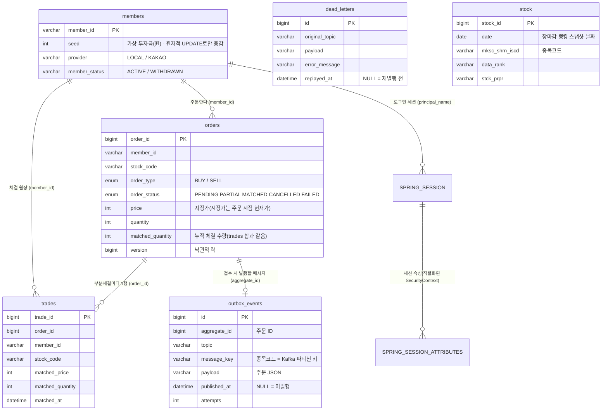

# DB 설계

MySQL 8.4(InnoDB) 기준. 스키마는 JPA 엔티티에서 `ddl-auto: update`로 생성되며, 아래 DDL은 실제 로컬 DB에서 `SHOW CREATE TABLE`로 뽑은 것이다(2026-10-30).

## 1. 테이블 관계 (ERD)



| 테이블 | 역할 | 쓰기 패턴 | 읽기 핫패스 |
|---|---|---|---|
| `orders` | 주문과 누적 체결 상태 | 접수 INSERT, 체결/취소 UPDATE(`@Version`) | 30초 배치의 대기 종목, 파티션 할당 시 대기 주문 로드, 매도 접수 시 예약 수량, 주문 내역 |
| `trades` | **불변 체결 원장** - 부분체결마다 1행 INSERT, 수정·삭제 없음 | INSERT만 | 보유종목·실현손익 계산(회원 원장을 시간순으로 훑음) |
| `members` | 회원 + 가상 투자금 | 잔고는 `seed = seed + delta` 원자적 UPDATE | 주문 접수 시 `SELECT ... FOR UPDATE` |
| `outbox_events` | Transactional Outbox - 주문과 같은 트랜잭션에 기록되는 "보낼 Kafka 메시지" | 접수 INSERT, 발행 시 `published_at` UPDATE | 즉시 발행(주문 ID), 1초 주기 재발행(미발행분) |
| `dead_letters` | 재시도 끝에 처리 못 한 Kafka 메시지 | DLT 소비 시 INSERT, 재발행 시 UPDATE | 어드민 미처리 목록 |
| `stock` | 장마감 거래량 순위 스냅샷(하루 30행) | 장 마감 후 하루 1회 INSERT | 재기동 시 최신 날짜 스냅샷 |
| `SPRING_SESSION*` | 로그인 세션(Spring Session JDBC) - 서버 여러 대가 공유 | 요청마다 갱신 | 세션 ID 조회 |

## 2. 핵심 테이블 DDL

```sql
-- 주문: 요청 수량/가격과 누적 체결 상태를 함께 관리. 체결 1건 = trades 1행
CREATE TABLE orders (
  order_id               BIGINT       NOT NULL AUTO_INCREMENT,
  member_id              VARCHAR(255) DEFAULT NULL,
  stock_code             VARCHAR(255) DEFAULT NULL,
  stock_name             VARCHAR(255) DEFAULT NULL,
  order_type             ENUM('BUY','SELL') DEFAULT NULL,
  order_status           ENUM('CANCELLED','FAILED','MATCHED','PARTIAL','PENDING') DEFAULT NULL,
  price_mode             ENUM('LIMIT','MARKET') DEFAULT NULL,
  auto_price_improvement TINYINT(1)   DEFAULT '0',     -- 지정가 매수 5% 자동 가격개선 사용 여부
  price                  INT          NOT NULL,
  quantity               INT          NOT NULL,
  matched_price          INT          NOT NULL,         -- 가장 최근 체결가
  matched_quantity       INT          NOT NULL,         -- 누적 체결 수량 (= trades 합)
  last_unmatched_reason  ENUM('NO_ELIGIBLE_PRICE','NO_ORDERBOOK_DATA','SYSTEM_ERROR') DEFAULT NULL,
  last_attempt_at        DATETIME(6)  DEFAULT NULL,
  created_at             DATETIME(6)  DEFAULT NULL,
  updated_at             DATETIME(6)  DEFAULT NULL,
  version                BIGINT       DEFAULT '0',     -- @Version: 체결 vs 사용자 취소 경쟁 시 나중 커밋이 실패
  PRIMARY KEY (order_id),
  KEY idx_orders_status_stock  (order_status, stock_code),
  KEY idx_orders_member_created (member_id, created_at)
) ENGINE=InnoDB;

-- 체결 원장: INSERT만 하는 불변 테이블. 조회를 위해 주문 정보 일부를 복제(아래 3장)
CREATE TABLE trades (
  trade_id         BIGINT       NOT NULL AUTO_INCREMENT,
  order_id         BIGINT       DEFAULT NULL,
  member_id        VARCHAR(255) DEFAULT NULL,
  stock_code       VARCHAR(255) DEFAULT NULL,
  stock_name       VARCHAR(255) DEFAULT NULL,
  order_type       ENUM('BUY','SELL') DEFAULT NULL,
  matched_price    INT          NOT NULL,
  matched_quantity INT          NOT NULL,
  matched_at       DATETIME(6)  DEFAULT NULL,
  PRIMARY KEY (trade_id),
  KEY idx_trades_member_matched (member_id, matched_at)
) ENGINE=InnoDB;

-- 회원: 잔고(seed)는 엔티티 읽고-쓰기가 아니라 UPDATE members SET seed = seed + ? 로만 바꾼다
CREATE TABLE members (
  member_id     VARCHAR(255) NOT NULL,
  password      VARCHAR(255) DEFAULT NULL,   -- BCrypt
  name          VARCHAR(255) DEFAULT NULL,
  email         VARCHAR(255) DEFAULT NULL,
  phone         VARCHAR(255) DEFAULT NULL,
  seed          INT          NOT NULL,
  level         INT          NOT NULL,
  member_status VARCHAR(255) DEFAULT NULL,
  provider      VARCHAR(255) DEFAULT NULL,   -- LOCAL / KAKAO
  account       VARCHAR(255) DEFAULT NULL,
  join_date     VARCHAR(255) DEFAULT NULL,
  login_time    DATETIME(6)  DEFAULT NULL,
  PRIMARY KEY (member_id)
) ENGINE=InnoDB;

-- Transactional Outbox: 주문 INSERT와 같은 트랜잭션. published_at IS NULL = 아직 Kafka로 안 나감
CREATE TABLE outbox_events (
  id           BIGINT        NOT NULL AUTO_INCREMENT,
  aggregate_id BIGINT        DEFAULT NULL,   -- 주문 ID
  topic        VARCHAR(255)  DEFAULT NULL,
  message_key  VARCHAR(255)  DEFAULT NULL,   -- 종목코드(= 파티션 키 → 종목 담당 서버)
  payload      VARCHAR(4000) DEFAULT NULL,   -- 주문 JSON
  created_at   DATETIME(6)   DEFAULT NULL,
  published_at DATETIME(6)   DEFAULT NULL,
  attempts     INT           NOT NULL,       -- 발행 실패 횟수
  last_error   VARCHAR(500)  DEFAULT NULL,
  PRIMARY KEY (id),
  KEY idx_outbox_unpublished (published_at, created_at)
) ENGINE=InnoDB;

-- DLQ 적재: 원인 확인 후 어드민 API로 원래 토픽에 재발행
CREATE TABLE dead_letters (
  id             BIGINT        NOT NULL AUTO_INCREMENT,
  original_topic VARCHAR(255)  DEFAULT NULL,
  message_key    VARCHAR(255)  DEFAULT NULL,
  payload        VARCHAR(4000) DEFAULT NULL,
  error_message  VARCHAR(1000) DEFAULT NULL,
  created_at     DATETIME(6)   DEFAULT NULL,
  replayed_at    DATETIME(6)   DEFAULT NULL,
  PRIMARY KEY (id)
) ENGINE=InnoDB;
```

`SPRING_SESSION`/`SPRING_SESSION_ATTRIBUTES`는 Spring Session이 제공하는 스키마를 그대로 쓴다(`spring.session.jdbc.initialize-schema: always`) - `SESSION_ID` 유니크, `EXPIRY_TIME`(만료 정리), `PRINCIPAL_NAME`(사용자별 세션) 인덱스 포함.

## 3. 정규화 / 비정규화 선택과 트레이드오프

| 선택 | 이유 | 대가 |
|---|---|---|
| **`trades`를 불변 원장으로 분리**(주문 1건 : 체결 N건) | 부분체결 이력이 남아야 실현손익(가중평균 매입단가)과 감사 추적이 가능. INSERT만 하므로 동시성 충돌이 없음 | 보유종목·손익은 원장을 매번 훑어 계산(아래 회원 단위 1.5초 캐시로 보완) |
| **`orders.matched_quantity`/`matched_price` 누적값 보관**(비정규화) | 체결 엔진이 주문마다 `SUM(trades)`를 하지 않고 남은 수량을 바로 판단 | trades 합과 어긋날 위험 → 체결 시 주문 UPDATE·trade INSERT·잔고 정산을 **한 트랜잭션**으로 묶어 같이 커밋되게 함 |
| **`trades`에 member_id·stock_code·order_type·stock_name 복제**(비정규화) | 손익 계산이 핫패스(보유주식 SSE가 시세 틱마다 호출)라 orders JOIN 없이 `member_id` 인덱스 하나로 끝냄. 원장은 수정되지 않으므로 복제본이 어긋날 일이 없음 | 행 크기 증가 |
| **외래키(FK) 제약 없음** | 엔티티를 연관관계 대신 ID로 참조하는 설계. 체결 트랜잭션마다 부모 행 공유 락(FK 검사)이 걸리지 않게 함 | 참조 무결성을 DB가 아니라 애플리케이션 트랜잭션이 보장. 회원 탈퇴는 상태값(`WITHDRAWN`)으로만 처리해 고아 행이 생기지 않게 함 |
| **Outbox payload를 `VARCHAR(4000)` 문자열로**(JSON 타입 아님) | 릴레이가 그대로 Kafka에 넘기기만 하고 DB에서 내부 필드를 조회하지 않음. JSON 타입의 검증·파싱 비용이 필요 없음 | DB에서 payload 안을 조건으로 검색할 수 없음(필요한 키는 `aggregate_id`·`message_key` 컬럼으로 따로 둠) |
| **enum을 문자열로 저장**(`@Enumerated(STRING)`) | 상태값 순서를 바꿔도 기존 데이터 의미가 안 바뀜 | 정수보다 저장 공간이 큼(행 수 대비 무시할 수준) |
| **`stock` 스냅샷은 KIS 응답 문자열 그대로** | 장마감 화면 복원용이라 계산에 쓰지 않음 | 숫자 정렬·집계를 DB에서 못 함 |

## 4. 인덱스 설계 - 핫패스 기준

### 측정 방법
- 로컬 MySQL 8.4에 운영 DB와 분리된 측정용 스키마를 만들고, 실제 테이블 구조를 그대로 복제한 뒤 합성 데이터를 넣음: 주문 200,000건(회원 2,000명, 종목 100개, **대기 주문 2%** - 나머지는 체결/취소 완료), 체결 150,000건, Outbox 200,000건(미발행 10건).
- 각 쿼리를 `EXPLAIN ANALYZE`로 5번 실행해 실제 실행시간 **중앙값**, `EXPLAIN`의 접근 방식(type)과 예상 읽기 행 수를 비교. 측정 후 측정용 스키마는 삭제.
- 수치는 이 합성 데이터·로컬 환경 기준이라 절대값보다 **스캔 방식(전체 스캔 → 인덱스 범위)과 읽는 행 수의 변화**가 핵심.

### 결과

| 핫패스 (호출 빈도) | 쿼리 | 인덱스 없음 | 인덱스 적용 후 | 사용 인덱스 |
|---|---|---|---|---|
| 30초 매칭 배치 - 대기 종목 목록 (서버마다 30초) | `SELECT DISTINCT stock_code FROM orders WHERE order_status IN ('PENDING','PARTIAL')` | 전체 스캔 199,743행, **43.4ms** | 범위 8,000행(커버링), **3.58ms** | `idx_orders_status_stock` |
| 파티션 할당·장마감 취소·어드민 - 대기 주문 전체 | `SELECT * FROM orders WHERE order_status IN (...)` | 전체 스캔, **68.7ms** | 범위 8,000행, **11ms** | `idx_orders_status_stock` |
| 매도 접수 - 예약 수량 합계 (**회원 행 락을 잡은 채 실행**) | `SUM(quantity - matched_quantity) ... WHERE member_id=? AND stock_code=? AND order_type='SELL' AND order_status IN (...)` | 전체 스캔, **49.4ms** | 범위 2행, **0.014ms** | `idx_orders_status_stock` |
| 주문 내역(최신순) | `... WHERE member_id=? ORDER BY created_at DESC` | 전체 스캔 + filesort, **69.9ms** | ref 100행, 역방향 인덱스 스캔(정렬 없음), **0.24ms** | `idx_orders_member_created` |
| 보유종목·실현손익 (보유주식 SSE, 회원별 1.5초 캐시) | `SELECT * FROM trades WHERE member_id=? ORDER BY matched_at` | 전체 스캔 + filesort, **41.5ms** | ref 75행, 정렬 없음, **0.148ms** | `idx_trades_member_matched` |
| Outbox 즉시 발행 (주문 접수마다) | `... WHERE aggregate_id=? AND published_at IS NULL` | 0.058ms | (추가 안 함) | 기존 `idx_outbox_unpublished` |
| Outbox 주기 재발행 (1초마다) | `... WHERE published_at IS NULL AND created_at < ? ORDER BY id LIMIT 100` | 0.036ms | (추가 안 함) | 기존 `idx_outbox_unpublished` |

### 설계 근거
- **`(order_status, stock_code)`**: 대기 주문은 전체 주문의 소수(측정 데이터 2%)이고 체결이 끝난 주문은 계속 쌓이기만 한다. 상태를 선두 컬럼으로 두면 대기분만 읽고, `stock_code`까지 인덱스에 있어 대기 종목 목록은 테이블을 안 읽고 인덱스만으로 끝난다(커버링).
- **매도 예약 수량용 인덱스를 따로 만들지 않은 이유**: 처음엔 `(member_id, stock_code, order_type, order_status)`를 추가했지만, 옵티마이저가 그 인덱스 대신 `idx_orders_status_stock`(대기 + 종목으로 2행만 남음)을 골랐다. 그 인덱스를 지우고 다시 재도 같은 실행계획·같은 시간(0.014ms)이라 삭제했다. 이 쿼리는 회원 행 락 안에서 돌기 때문에 전체 스캔(49ms)이면 같은 회원의 다음 주문이 그만큼 락을 기다리게 되는데, 기존 인덱스로 해결된다.
- **`(member_id, created_at)` / `(member_id, matched_at)`**: 회원 조건 + 시간 정렬을 인덱스 순서로 바로 읽어 filesort를 없앤다. 체결 원장 쪽은 보유주식 SSE가 시세 틱마다 부르는 경로라 캐시가 만료될 때마다 이 쿼리가 실행된다.
- **Outbox에 `aggregate_id` 인덱스를 추가하지 않은 이유**: 처음엔 추가하려 했지만, 미발행 이벤트가 항상 소수라 기존 `(published_at, created_at)` 인덱스로 미발행분만 읽고 끝난다(0.058ms). 측정해 보고 뺐다.
- **쓰기 비용**: 주문 10,000건 INSERT를 3번 반복 측정 - 보조 인덱스 2개 있을 때 118~122ms, 없을 때 68~80ms. 주문 1건당 약 0.005ms 추가로, 읽기 쪽 개선(수십 ms → 1ms 미만)에 비해 작다.
- `stock`(하루 30행), `dead_letters`(장애 시에만 쌓임)는 행 수가 작아 인덱스를 두지 않았다.

## 5. 동시성과 정합성을 위한 스키마 장치

| 장치 | 위치 | 막는 것 |
|---|---|---|
| `SELECT ... FOR UPDATE` (비관적 락) | `members` 행, 주문 접수 시 | 같은 회원의 동시 주문이 잔고/보유수량을 넘어서 접수되는 것 |
| `UPDATE members SET seed = seed + ?` | 체결 차액 환급, 취소 환급 | 잔고 증감끼리 덮어써서 금액이 사라지는 것(lost update) |
| `orders.version` (`@Version`, 낙관적 락) | 체결 vs 사용자 취소 | 체결과 환급이 둘 다 반영되는 것, 취소된 주문이 체결로 되살아나는 것 |
| 락 순서 통일(주문 행 → 회원 행) | 체결·취소·장마감 취소 | 두 트랜잭션이 서로의 행을 기다리는 데드락 |
| `outbox_events` 행 락 + `published_at` | 발행 | 같은 메시지를 여러 서버·경로가 중복 발행하는 것 |

각 장치는 하나씩 빼고 돌리면 실패하는 통합 테스트(실제 MySQL 컨테이너)로 검증했다 - [issue.md](../issue.md) 참고.

## 6. 한계와 다음 단계

- **스키마 마이그레이션 도구 없음**: `ddl-auto: update`라 컬럼 추가는 되지만 삭제·타입 변경은 반영되지 않는다(예: 이번에 엔티티에서 뺀 `stock`의 미사용 컬럼 14개가 DB에는 남아 있음). Flyway로 버전 관리 전환이 다음 단계.
- **금액이 `INT`**: 최대 약 21억 원. 가상 투자금 1,000만 원 기준으론 충분하지만 실서비스라면 `BIGINT`(원 단위) 또는 `DECIMAL`이 맞다.
- **전화번호 중복 확인이 애플리케이션 검사뿐**: 동시 가입 시 중복이 생길 수 있음 → `phone` 유니크 인덱스 필요(기존 데이터 중복 정리 후).
- 문자열 컬럼 길이가 대부분 JPA 기본값 `VARCHAR(255)`, NOT NULL 제약도 대부분 없음 - 엔티티에 `@Column(nullable=false, length=...)`로 명시하는 정리가 필요.
